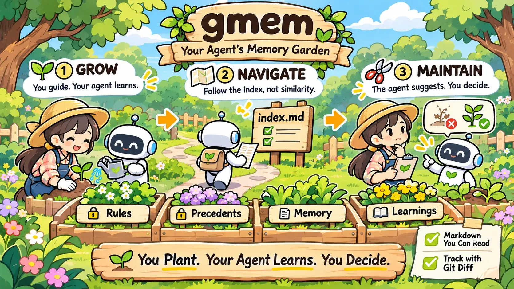
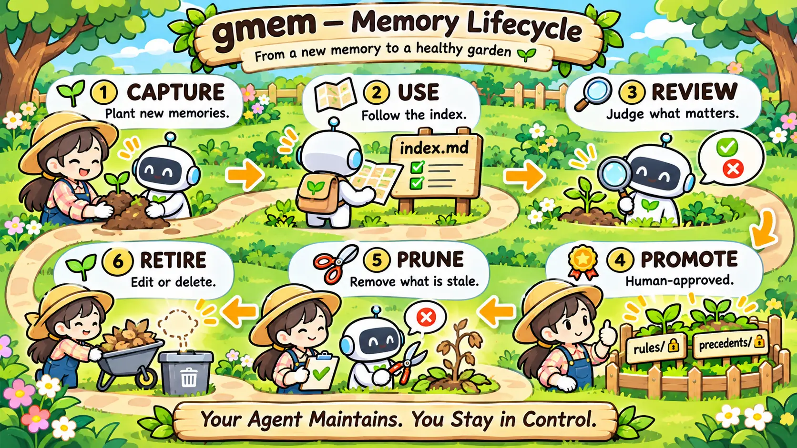

# gmem



Most agent memory works like a recorder: it saves everything automatically and
finds things again with semantic search, usually a vector index. You don't see
what was kept, and you can't easily tell why one memory came back and another
didn't.

gmem is a garden. Memory is plain Markdown in a folder you own. The agent still
writes much of it, but each skill saves only what passes its own test, into a file
you can open. The agent walks through it at the start of every task and finds files
by their index rows, not by similarity. You decide what stays, and you prune it so
the paths stay clear.

- **You plant, the agent learns.** You tell the agent what to remember
  (`gmem-memory`, `gmem-note`) and correct it when it is wrong (`gmem-stop`). The
  agent keeps what it learns on its own with `gmem-learn`. Either way, it saves only
  through a gmem skill, into a Markdown file you can read.
- **You lay the paths.** Each layer has an `index.md`, one row per file saying
  when to read it. The agent follows those rows instead of guessing by similarity.
- **You prune.** `gmem-judge` and `gmem-tidy` find what's stale, duplicated or
  wrong. You approve what gets cut or moved.
- **Some beds are fenced.** `rules/` and `precedents/` change only when a human
  decides. The agent can suggest, never rewrite.

A garden like this needs some work from you. In return, every memory can be read,
checked with `git diff`, and traced to whoever wrote it.

## Install

### Claude Code (plugin)

Add the marketplace, then install the plugin:

```
/plugin marketplace add thaitype/gmem
/plugin install gmem@gmem
```

`gmem` has the memory skills and the session-start hook.

We recommend that you turn off Claude Code's own auto memory. Otherwise Claude Code
also saves memories on its own, outside gmem, and you lose the single place where you
decide what is kept. Add this to `~/.claude/settings.json`:

```json
{
  "env": {
    "CLAUDE_CODE_DISABLE_AUTO_MEMORY": "1"
  }
}
```

If the file already has an `env` block, add the key to it. The setting takes effect in
the next session.

### Other agents

```
npx skills@latest add thaitype/gmem
```

This installs the skills only, without the hook. See
[Opening the map at session start](#opening-the-map-at-session-start).

## Quick start

In this walkthrough, you set up gmem in one project, save how something works and
where a piece of work stands, and see the agent pick up both in a fresh session. It
assumes you installed the Claude Code plugin.

1. Open Claude Code in your project and run the setup skill:

   ```
   /gmem-setup
   ```

   The agent asks two questions, one at a time. For where the config lives, choose
   **Project level** (the other option is **User level**, shared by every project), and **Recommended** for where each kind of memory lives. When it
   finishes, it prints the folders it resolved:

   ```
   memory     -> /path/to/project/.gmem/memory
   note       -> /path/to/project/.gmem/note
   rules      -> /Users/you/.gmem/rules
   precedents -> /Users/you/.gmem/precedents
   learnings  -> /Users/you/.gmem/learnings
   proposals  -> /Users/you/.gmem/proposals
   retro      -> /Users/you/.gmem/retro
   config     -> /path/to/project/.gmem/gmem-config.toml
   ```

   With **Recommended**, this project's context and status stay in the project. What
   the agent learns and what you decide live in your home directory, so they carry
   across projects.

   It also checks for `grilling`, `wayfinder`, and `research`, three skills from
   [mattpocock/skills](https://github.com/mattpocock/skills), and offers to install
   any that are missing. You can skip them for now. Only `gmem-tidy` uses them.
2. Start a fresh session with `/clear`.

   Claude Code shows **Opening the gmem map** while the hook runs, and the agent loads `gmem-map`
   before it answers you. The hook fires now because the project has a
   `.gmem/gmem-config.toml`.
3. Tell the agent how something in your project works:

   ```
   Add to memory: the staging database resets every Sunday at 02:00 UTC, so test
   data written there does not survive the weekend.
   ```

   The agent runs `gmem-memory`. It writes a topic file such as
   `.gmem/memory/active/reference/staging-database.md`, and adds a row for it to
   `.gmem/memory/active/index.md`:

   ```md
   | reference/staging-database.md | Before writing test data to staging, or when staging data goes missing |
   ```

   The row says when to read the file. The agent uses it to decide whether the file
   is relevant to a task.
4. Tell the agent where a piece of work stands:

   ```
   Leave a status note: we're moving the test fixtures into the seed script. The
   users table is done. The orders table is next.
   ```

   The agent runs `gmem-note` and writes a file such as
   `.gmem/note/2026-11-19_1430_seed-script-fixtures.md`:

   ```md
   ---
   status: in-progress
   ---

   ## Current status
   - Users table fixtures are in the seed script.

   ## Next steps
   - Move the orders table fixtures.
   ```
5. Run `/clear` again, then ask:

   ```
   Where did we leave off with the seed script? Anything I should know before I run
   it on staging?
   ```

   The agent runs `gmem-recall`. It reads `active/index.md` and every note marked
   `in-progress` or `blocked` on every task. It answers from the note, opens
   `reference/staging-database.md` because its row matches, and names both files as
   sources.
6. End the session the way you normally would, for example "done for now".

   The agent runs `gmem-bye`. It checks whether there is a note, a memory update, a
   retro, or a learning worth writing, and writes only the ones that qualify. If the
   orders table got done in this session, it updates the note.

You now have a project with memory that the agent reads at the start of every
session. Learnings come later. The agent writes them with `gmem-learn` when it learns
something on its own: from your guidance, from a mistake it made, or from something it
found out while it worked.

Everything is plain Markdown. The project's memory and notes are under the project's
`.gmem/`. Commit that folder if you want your team to share them. Learnings, rules, and
the other user-level kinds are under `~/.gmem/`, so they are not in the project's git
history.

## Memory lifecycle



The agent writes most of the memory. You decide what stays, what gets promoted, and
what goes. This section describes each stage and what you do in it.

### Capture: the agent writes, you point

Memory enters in five ways. Each kind has its own skill and its own folder. With the
recommended setup, `memory/` and `note/` are in the project's `.gmem/`, and the rest are
in `~/.gmem/`:

| You want to keep                                                 | Skill           | Where it goes                          |
| ---------------------------------------------------------------- | --------------- | -------------------------------------- |
| Context you tell the agent to remember: how something works, the state of a system | `gmem-memory` | `memory/active/reference/<topic>.md` |
| Something the agent learned on its own: from your guidance, a mistake, or a finding | `gmem-learn`  | `learnings/<slug>.md`                |
| A mistake the agent made, and what to do instead                 | `gmem-stop`   | `memory/active/correction/`          |
| Where a piece of work stands, so the next session can pick it up | `gmem-note`   | `note/YYYY-MM-DD_HHMM_<topic>.md`    |
| The story of a session: decisions, dead ends, open threads       | `gmem-retro`  | `retro/YYYY-MM-DD-<slug>.md`         |

The first two rows split on who knows the fact first. If you tell the agent something,
it is memory. If the agent works something out, it is a learning.

The agent reaches for `gmem-learn` on its own when it learns something worth keeping.
`gmem-bye` runs at the end of a session and checks the other kinds. The one you call
yourself is `gmem-stop` (`/gmem-stop`). Run it the moment you correct the agent, because the agent
never runs it on its own. A one-line correction goes into
`active/correction/lessons.md`, which `gmem-recall` reads on every task. A longer one
gets its own file in `active/correction/` and a row in `active/index.md`.

### Use: the agent reads in a fixed order

Before non-trivial work, `gmem-recall` reads `rules/index.md`, `precedents/index.md`,
`active/index.md`, `active/correction/lessons.md`, and the notes marked
`in-progress` or `blocked`. It opens only the
files whose index row matches the task. When two layers disagree, the higher one wins:

```
rules/ > precedents/ > active/ > learnings/
```

Notes and retros give context only. They never override a layer. `gmem-recall` opens
learnings, retros, and notes marked `done` only when a task needs them, for example
when you ask "have we hit this before?"

The order matters for what you maintain. An index row that says when to read a file
is how the agent finds it. A file without a row is easy to miss, so `gmem-recall` and
`gmem-tidy` both report any file that has no row.

### Review: the judge sorts, you decide

Run `gmem-judge` after a batch of learnings piles up. It reads every learning with an
empty `reviewer` field and does one of three things:

- It fixes small problems in place, such as a learning that holds two facts or tells a
  story.
- It writes a proposal in `proposals/` when a learning should be promoted,
  conflicts with a rule or precedent, or is unclear.
- It leaves a clean learning alone.

It then sets `reviewer`, so the next run skips that file. Nothing waits on you here. A
learning stays usable whether or not anyone reads its proposal.

### Promote: only you change rules and precedents

Read `~/.gmem/proposals/` when you have time. For a proposal you agree with, add the
file to `precedents/` or to `rules/<topic>.md`, and add its row to that folder's
`index.md` in the same commit. The proposal already contains the row, so you can copy
it. The agent never writes to `rules/` or `precedents/`. That limit is what makes the
top of the authority order something you can trust.

Promote rarely. A rule is for something that must never be broken. A precedent is for
a decision the agent should follow unless it states a reason not to. Most learnings
stay learnings, and that is fine.

### Prune: tidy against the real code

Run `gmem-tidy` now and then, and always when the agent starts acting on facts that
are no longer true. It reads every file in the scope you choose and checks each one against
the code and scripts it describes, not only against other memory. A memory line that
contradicts the code does the most damage, because the agent trusts it.

`gmem-tidy` reports what it found and asks you to decide each fix, one question at a
time or through `grilling` or `wayfinder` if you installed them. After you confirm,
it moves files with `git mv`, writes one ledger entry that records what changed, and
rebuilds the index files.

### Retire: edit or delete

When something in `active/` stops being true, edit it or delete it. gmem has no
archive and no "inactive" flag. If you want a record of what used to be believed,
write a dated ledger entry in `memory/` before you change the file. Set a finished
note's `status` to `done`, so `gmem-recall` stops reading it.

## Where memory is stored

Each kind of memory has its own location in the gmem config: `memory`, `note`,
`rules`, `precedents`, `learnings`, `proposals`, and `retro`. Run `gmem-setup` to choose
them. **Recommended** keeps `memory` and `note` in the project and the other five in
your home directory. **Custom** asks about each kind on its own.

With no config, gmem uses the recommended split:

```
<project>/.gmem/memory/      gmem-memory: ledger and active/
<project>/.gmem/note/        gmem-note
~/.gmem/rules/
~/.gmem/precedents/
~/.gmem/learnings/           gmem-learn
~/.gmem/proposals/           gmem-judge
~/.gmem/retro/               gmem-retro
```

In the config, `${PROJECT}` stands for the project root and `${USER}` for your home
directory. For example, `learnings = "${PROJECT}"` keeps learnings in
`<project>/.gmem/learnings/`.

To share rules and precedents with your team, choose **Custom** in `gmem-setup` and
set `rules` and `precedents` to the project. They then live in the project's `.gmem/`
and go into git with it.

## Migrating older memory

gmem used to be called typmem. The `gmem-tools` plugin has `gmem-migrate`, a
manual-only skill that moves memory from older versions (`.typmem/` folders,
`~/.typmem/memory/`, a single `rules.md`, precedents without an
index) or from a crew-style `locker/` layout into the current one. It
shows a dry-run plan first, asks before every judgment call, and never deletes files.

To use it in Claude Code, install the plugin from the same marketplace, then run the
skill:

```
/plugin install gmem-tools@gmem
/gmem-migrate
```

The `npx skills@latest add thaitype/gmem` install already includes `gmem-migrate`.

## Opening the map at session start

Installed as a Claude Code plugin, gmem has a `SessionStart` hook that tells the agent
to open `gmem-map` before its first task. It speaks up only in projects that use gmem:
a `gmem-config.toml` or `.gmem/` folder at the repository root, or a user-level
`~/.gmem/gmem-config.toml`.

If you installed the skills without the plugin (`npx skills@latest add`), there is no hook.
Place this in CLAUDE.md instead:

```md
## Memory (gmem)

This project uses gmem. At the start of a session or before non-trivial work, open
`gmem-map` and follow it.
```

The map itself lives in the `gmem-map` skill, so updating the plugin updates every
project that points to it.
